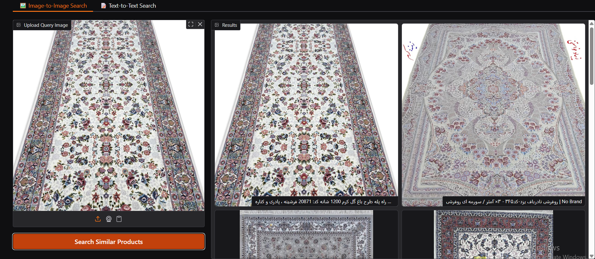
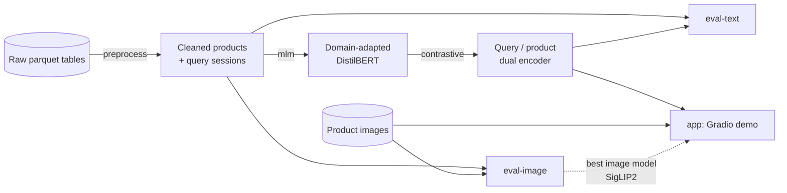
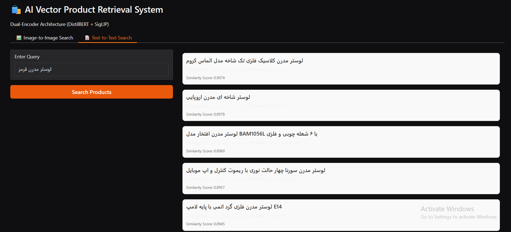
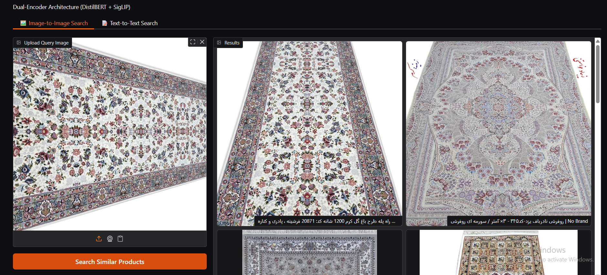

# RAGSearch: Persian e-commerce product retrieval

Semantic product search over ~1M Persian e-commerce listings, built as a university MLOps course project.
Users can search **by text** (a query encoder and a product encoder trained on real search logs) or **by image**
(zero-shot image embeddings), and both are served through a small Gradio demo.

* **Text-to-product:** a DistilBERT dual encoder, domain-adapted with MLM and trained with a contrastive loss on
  (query, opened product) pairs. In the original run it scored validation NDCG 0.165 against 0.105 for the best
  off-the-shelf Persian embedding model (see [Results](#results)).
* **Image-to-product:** four pretrained vision encoders compared; SigLIP2 wins (test NDCG 0.276 on the augmented set).
* **Reproducible pipeline:** one YAML config and one CLI (`ragsearch <stage>`) take you from raw tables to the demo.

| Text search | Image search |
|---|---|
|  |  |

## How it works



| Stage | Command | What it does |
|---|---|---|
| 1 | `ragsearch preprocess` | Joins products with category/brand names, builds retrieval text, normalises Persian with [Hazm](https://github.com/roshan-research/hazm), aggregates search pages into one row per search session and drops inconsistent or empty ones. |
| 2 | `ragsearch mlm` | Masked-language-model adaptation of `HooshvareLab/distilbert-fa-zwnj-base` on a 50/50 mix of product and query text. |
| 3 | `ragsearch contrastive` | Trains separate query and product towers (InfoNCE with mixed hard/easy negatives + an auxiliary product-category classifier). |
| 4a | `ragsearch eval-text` | Compares 4 text retrievers with FAISS exact search; selects on validation NDCG, reports the winner on test. |
| 4b | `ragsearch eval-image` | Compares CLIP, ConvNeXtV2, SigLIP2 and DINOv3 on image-to-image retrieval built from co-clicked products. |
| 5 | `ragsearch app` | Gradio UI with paginated text and image search over the full catalogue. |

Details of the data, objectives and evaluation protocol are in [docs/methodology.md](docs/methodology.md).

## Results

All numbers come from the original Colab runs (single run, seed 42) and are stored in [`results/`](results).
Ground truth is "the user opened this product for this query".

### Text-only (query to product text; 623,636 candidate products, 24,134 validation / 24,134 test queries)

| Model | Split | MRR | NDCG | P@3 | R@10 | R@40 |
|---|---|---|---|---|---|---|
| Heydari-Persian-Emb | Validation | 0.0811 | 0.1050 | 0.0301 | 0.1188 | 0.2316 |
| Hooshvare-DistilBert | Validation | 0.0389 | 0.0433 | 0.0141 | 0.0482 | 0.0854 |
| Custom-MLM-Base | Validation | 0.0434 | 0.0512 | 0.0156 | 0.0547 | 0.1085 |
| **Custom-Dual-Contrastive** | Validation | **0.1270** | **0.1652** | **0.0492** | **0.1915** | **0.3713** |
| **Custom-Dual-Contrastive** | **Test** | 0.1252 | 0.1626 | 0.0478 | 0.1866 | 0.3683 |

Full metrics (P/R/F1 at k = 3, 5, 10, 20, 40): [`results/text_only/metrics.csv`](results/text_only/metrics.csv).

### Image-only (product image to co-clicked products; 9,151 candidate products)

| Model | Stage | MRR | NDCG | P@3 | R@10 | R@40 |
|---|---|---|---|---|---|---|
| CLIP ViT-B/16 | Val (augmented) | 0.1703 | 0.1716 | 0.0735 | 0.1773 | 0.3173 |
| ConvNeXtV2-base | Val (augmented) | 0.2142 | 0.2280 | 0.0949 | 0.2349 | 0.4363 |
| DINOv3 ViT-S/16 | Val (augmented) | 0.2062 | 0.2226 | 0.0954 | 0.2490 | 0.4194 |
| **SigLIP2 so400m** | Val (augmented) | **0.2919** | **0.3026** | **0.1285** | **0.3408** | **0.5157** |
| **SigLIP2 so400m** | **Test (pure, 68 queries)** | 0.2095 | 0.2884 | 0.0931 | 0.3824 | 0.5956 |
| **SigLIP2 so400m** | **Test (augmented, 752 queries)** | 0.2609 | 0.2762 | 0.1130 | 0.3184 | 0.5080 |

Pure/augmented validation rows for every model: [`results/image_only/metrics.csv`](results/image_only/metrics.csv).

## Demo

More screenshots are in [`docs/images/`](docs/images). The demo is a good illustration of both strengths and limits:
product-type queries (a TV, a chandelier) work well, while heavily misspelled queries return unrelated products.

| Query "red modern chandelier" | Query photo of a carpet runner |
|---|---|
|  |  |

## Repository layout

```
.
├── configs/default.yaml        # the one config file: paths, preprocessing, training, evaluation, app
├── src/ragsearch/
│   ├── cli.py                  # `ragsearch <stage>` entry point
│   ├── config.py               # typed config loaded from YAML
│   ├── data/                   # raw tables -> cleaned products/queries; splits; product catalogue
│   ├── models/                 # dual encoder, text encoders for evaluation, image encoders
│   ├── training/               # MLM adaptation, contrastive training, loss-curve plots
│   ├── evaluation/             # metrics, FAISS index, text and image evaluation runners
│   └── app/                    # search engine + Gradio UI
├── notebooks/01_eda.ipynb      # exploratory data analysis (with saved outputs)
├── tests/                      # pytest suite (synthetic data; no GPU, no downloads needed)
├── results/                    # metrics CSVs from the reported runs
├── docs/                       # methodology, screenshots
└── data/                       # raw / processed data and images (not committed, see data/README.md)
```

## Getting started

Requires Python 3.10+. A GPU is strongly recommended for `mlm`, `contrastive`, `eval-*` and the demo (the original
runs used a Colab GPU); `preprocess` and the tests run on any machine.

Preprocessing and the ML stages need **two separate environments**, because [Hazm](https://github.com/roshan-research/hazm)
pins `numpy==1.24.3` (no wheels for Python 3.12+, and it clashes with current PyTorch builds):

```bash
git clone <this repo> && cd RAGSearch

# Environment A - preprocessing only (Python 3.10 or 3.11)
python -m venv .venv-prep && source .venv-prep/bin/activate      # Windows: .venv-prep\Scripts\activate
pip install -e ".[preprocess]"
ragsearch preprocess && deactivate

# Environment B - training, evaluation, demo and tests (e.g. a Colab notebook)
python -m venv .venv && source .venv/bin/activate
pip install -e ".[ml,app]"                 # add ,eda for the notebook and ,dev for pytest
# On a CUDA machine you may prefer: pip uninstall faiss-cpu && pip install faiss-gpu-cu12
```

The preprocessed parquet files in `data/processed/` are plain files, so you can create them locally and copy them to
wherever you train.

**1. Provide the data** as described in [`data/README.md`](data/README.md): the raw parquet tables in `data/raw/`
and, for image experiments and the demo, `data/images/<random_key>.jpg`.

**2. Run the pipeline** from the repository root (every command accepts `--config path/to/other.yaml`; everything after `preprocess` runs in environment B):

```bash
ragsearch preprocess      # data/raw       -> data/processed/*.parquet   (environment A)
ragsearch mlm             # processed text -> artifacts/mlm_model/
ragsearch contrastive     # mlm_model      -> artifacts/retrieval_system_full.pth
ragsearch eval-text       # -> results/text_only/metrics.csv  (appends a row per run)
ragsearch eval-image      # -> results/image_only/metrics.csv (overwrites)
ragsearch app             # Gradio demo; add --share for a public link, --port 7860 to pick a port
```

`ragsearch` is equivalent to `python -m ragsearch`. Stages are independent once their inputs exist: for example,
the text baselines in `eval-text` need only `preprocess`; DINOv3 is gated on the Hugging Face Hub, so run
`huggingface-cli login` or set `HF_TOKEN` first (a model that fails to load is skipped, not fatal).

> `eval-text` and `eval-image` write into `results/`, which holds the numbers reported above. Point
> `paths.results_dir` somewhere else in your config (or use git) if you don't want a new run to modify them.

**On Colab:** clone the repo, `pip install -e ".[ml,app]"`, upload/mount the *preprocessed* parquet files and images under `data/`, and run the same commands with `!`.

**3. Run the tests:**

```bash
pip install -e ".[ml,app,dev]" && pytest          # the one test that needs Hazm is skipped here (run it in environment A)
```

Verified with Python 3.11, `transformers` 5.x and PyTorch 2.x on CPU. The code adapts to the `transformers` 4.x API
differences it is aware of (`warmup_ratio`, `get_image_features`).

The suite uses synthetic tables, a tiny randomly initialised BERT and stub encoders, so it needs no data, GPU or network.
It covers the preprocessing filters, metric formulas (hand-computed expectations), negative sampling, the dual-encoder
checkpoint format, evaluation plumbing (including image/key alignment) and the demo's search and HTML rendering.

## Configuration

Everything lives in [`configs/default.yaml`](configs/default.yaml), grouped per stage (`preprocessing`, `model`, `mlm`,
`contrastive`, `text_eval`, `image_eval`, `app`). Unknown keys are rejected, so typos fail fast. Common edits:

* change what goes into the product text: `preprocessing.product_text.include_brand` / `include_category`;
* add or remove text systems to compare: `text_eval.experiments` (types: `sentence_transformer`, `hf_automodel`, `custom_dual`);
* compare other image models: `image_eval.models` (any Hugging Face vision model id);
* use a fraction of the data for quick runs: `text_eval.query_subset_ratio`, `image_eval.data_sample_fraction`.
